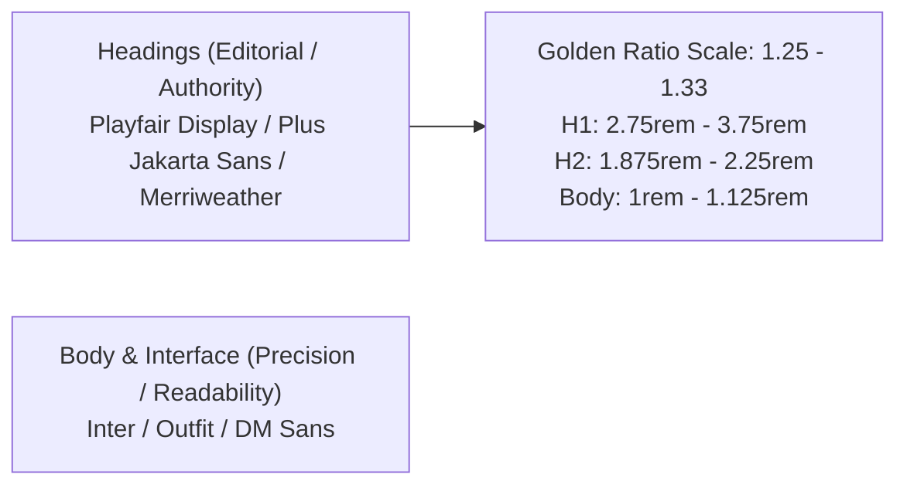

# UI/UX & Design System: Eliminating the "Generic AI Slop" Look

> **PRIMARY OBJECTIVE**: Build interfaces that exude human craftsmanship, visual hierarchy, authoritative credibility, and flawless responsiveness. Never produce generic, cookie-cutter AI templates.

---

## 1. Why Clients Hate "AI-Generated" Designs & How We Fix It

Clients and users intuitively recognize low-effort AI web designs because they exhibit distinct anti-patterns:
- **The Empty Hero Void**: A centered H1 floating in a massive, bland gray or white rectangle with no depth, no texture, and no visual anchor.
- **The Monotonous Color Palette**: Every element is the same flat shade of blue or purple with no contrast dynamics.
- **The Dense Wall of Text**: Paragraph after paragraph of unstyled, unformatted body copy with zero scannability.
- **Broken Empty Placeholders**: Gray boxes where images should be, undefined numbers in process steps, and empty accordion triggers.
- **Careless Mobile Overflow**: Broken tables running off the screen, non-wrapping pills, and microscopic button touch targets.

---

## 2. Typography Token Standards

Every site must feature an **authoritative typographic pairing** that separates editorial dignity from functional interface elements:



### Typographic Hierarchy Rules:
- **Heading Line Height**: Tight line height for titles (`leading-tight` or `leading-[1.15]`). Headings must never feel loose or disconnected.
- **Body Line Height**: Generous line height for reading comfort (`leading-relaxed` or `leading-[1.7]`).
- **Heading Hierarchy**:
  - `H1`: Exactly one per page. Bold, expressive, containing the primary service and geo-target.
  - `H2`: Clear section anchors. Accompanied by section badges or eyebrow pills.
  - `H3`: Sub-points and component cards. Never skip levels (no jumping from `H1` directly to `H3`).

---

## 3. High-Contrast Color System & Accessibility (WCAG 4.5:1+)

Every palette must pass **WCAG AA (4.5:1) for body text and 3:1 for large text**. Use CSS variables or Tailwind tokens:

### Palette Structure:
1. **Dominant Canvas Background**:
   - *Light Theme*: Crisp warm slate/zinc (`bg-slate-50` or `bg-zinc-50`), with white cards (`bg-white`).
   - *Dark Theme*: Deep rich obsidian (`bg-slate-950` or `bg-zinc-950`), with subtle charcoal cards (`bg-zinc-900/80`).
2. **Primary Brand Accent (40% Weight)**:
   - Deep Royal Navy (`#0F172A` / `#1E3A8A`), Forest Emerald (`#064E3B` / `#047857`), or Surgical Copper (`#7C2D12` / `#C2410C`).
3. **High-Contrast Call-to-Action Color (10% Weight)**:
   - Amber / Gold (`#F59E0B` / `#D97706`), Radiant Emerald (`#10B981`), or Vivid Electric Blue (`#256FDC`).
   - Must contrast strongly against both background cards and text.

---

## 4. Hero Blueprints That Look Human-Crafted

Never render a bare H1 in an empty rectangle. Use one of these three battle-tested Hero architectures:

### Hero Pattern A: Split-Screen Form Hero (High Lead-Gen)
- **Left Column (60% Desktop)**:
  - Trust Eyebrow Pill: `[ ⚡ 24/7 Rapid Local Dispatch • Licensed & Insured Network ]` (subtle border, colored badge).
  - High-Impact H1: 3-4 lines maximum, bold typography, highlighted accent words.
  - Bulleted Value Points: 3 clear checkmark items with specific numbers (*"Avg. 45-Min Arrival"*, *"100% Free On-Site Estimates"*).
  - Social Proof Strip: Star rating badge with real customer count (*"Rated 4.9/5 by 380+ Local Property Owners"*).
- **Right Column (40% Desktop)**:
  - Elevated Card Container: `bg-white dark:bg-zinc-900 rounded-2xl shadow-xl border border-slate-200 dark:border-zinc-800 p-6`.
  - Instant 2-Step Quote Funnel or Triage Estimator.

### Hero Pattern B: Centered Authority Proof Hero (High Trust / Professional)
- **Top Badge**: Glowing ambient pill with shield icon (*"Accredited Family Mediation Council Registry"*).
- **Centered Editorial H1**: Elegant serif typography with balanced word wrapping (`max-w-3xl mx-auto`).
- **Sub-headline**: 2 sentences explaining the core value proposition with zero fluff.
- **Dual Action Bar**:
  - Primary Button: `[ 📞 Call Dispatch: (XXX) XXX-XXXX ]` (high-contrast vibrant color, hover lift).
  - Secondary Button: `[ ⚡ Request Confidential Assessment ]` (subtle white/dark backdrop blur).
- **Credential Marquee**: A 4-logo strip featuring official industry associations, municipal compliance badges, or ISO/FMC accreditations.

### Hero Pattern C: Technical SOP Hero (Industrial / Code-Heavy Trades)
- Left-aligned technical H1 with direct BLUF summary capsule.
- Right-aligned live operational status card (*"Current Response Status: Priority Dispatch Active"*).
- Highway corridor or service radius map snippet.

---

## 5. Opening Text & Summary Formatting (The Anti-Wall-of-Text Rule)

Never present opening summaries as dense, gray blocks of text. Transform them into **Structured Executive Summary Cards**:

```html
<!-- Example of High-Scannability Executive Summary Card -->
<div class="rounded-2xl p-6 sm:p-8 bg-amber-50/70 border-2 border-amber-200 dark:bg-zinc-900 dark:border-zinc-800 shadow-sm my-8">
  <div class="flex items-start gap-4">
    <div class="w-10 h-10 rounded-xl bg-amber-500 text-slate-950 flex items-center justify-center shrink-0 font-bold">
      <svg class="w-5 h-5" fill="none" stroke="currentColor" viewBox="0 0 24 24"><path stroke-linecap="round" stroke-linejoin="round" stroke-width="2" d="M9 12l2 2 4-4m5.618-4.016A11.955 11.955 0 0112 2.944a11.955 11.955 0 01-8.618 3.04A12.02 12.02 0 003 9c0 5.591 3.824 10.29 9 11.622 5.176-1.332 9-6.03 9-11.622 0-1.042-.133-2.052-.382-3.016z"/></svg>
    </div>
    <div class="space-y-4 w-full">
      <div class="flex items-center gap-2">
        <span class="px-2.5 py-0.5 rounded-full text-xs font-bold uppercase tracking-wider bg-amber-500/20 text-amber-900 dark:text-amber-300">
          Executive Summary &amp; Key Findings
        </span>
      </div>
      
      <p class="text-slate-900 dark:text-zinc-100 text-base leading-relaxed font-medium">
        In <strong>Maricopa County, Arizona</strong>, commercial EV charger installations require compliance with 
        <strong>NEC Article 625</strong> and City of Phoenix municipal electrical amendments. Average turnaround 
        spans <strong>3 to 5 business days</strong> with costs ranging from <strong>$2,800 to $6,500 per port</strong>.
      </p>

      <!-- Numbered Empirical Finding Badges -->
      <div class="grid grid-cols-1 sm:grid-cols-2 gap-3 pt-2">
        <div class="flex items-start gap-2.5 bg-white dark:bg-zinc-950 p-3 rounded-xl border border-amber-100 dark:border-zinc-800">
          <span class="text-xs font-bold text-amber-600 dark:text-amber-400 font-mono">01.</span>
          <p class="text-xs text-slate-700 dark:text-zinc-300">
            <strong class="text-slate-900 dark:text-white">PERMIT PROTOCOL:</strong> Dual electrical plan submission mandated for commercial 480V installations.
          </p>
        </div>
        <div class="flex items-start gap-2.5 bg-white dark:bg-zinc-950 p-3 rounded-xl border border-amber-100 dark:border-zinc-800">
          <span class="text-xs font-bold text-amber-600 dark:text-amber-400 font-mono">02.</span>
          <p class="text-xs text-slate-700 dark:text-zinc-300">
            <strong class="text-slate-900 dark:text-white">PRICING BENCHMARK:</strong> Dedicated 240V/50A residential installation averages $750 - $1,400.
          </p>
        </div>
      </div>
    </div>
  </div>
</div>
```

---

## 6. Mobile Responsiveness & Breakpoint Standards

Every page must render impeccably across **6 standard viewport sizes**:
- **320px** (Old mobile / small displays)
- **375px - 414px** (Standard mobile iPhones / Androids)
- **640px** (Large mobile / landscape)
- **768px** (iPads / tablets)
- **1024px** (Laptops)
- **1280px+** (Desktop monitors)

### Responsive Rules:
1. **Zero Horizontal Scrolling**: Add `overflow-x-hidden` on `<body>` and `<html>`. Never set fixed pixel widths on layout containers (e.g., `w-[750px]`). Always use `max-w-* w-full`.
2. **Tables in Responsive Wrappers**: Every HTML `<table>` must be wrapped in `<div class="w-full overflow-x-auto my-6 border rounded-xl">` with clear cell padding.
3. **Pill & Badge Wrapping**: Groups of tags or badges must always include `flex-wrap gap-2`. Never allow pills to clip off-screen.
4. **Touch Target Dimensions**: All buttons, links, and form selectors must have a minimum clickable height of **44px to 48px** on mobile viewports.

---

## 7. Form Controls & Accessibility (Zero Unlabeled Inputs)

Every input, select, and textarea element **MUST** have an explicit label to satisfy Core Web Vitals accessibility audits:

```tsx
// ❌ WRONG (Causes accessibility failure & form errors):
<input type="text" placeholder="Enter your Zip Code" className="..." />

// ✅ CORRECT:
<div className="space-y-1.5">
  <label htmlFor="user-zip" className="block text-xs font-semibold text-slate-700 dark:text-zinc-300">
    Service Zip Code <span className="text-red-500">*</span>
  </label>
  <input
    id="user-zip"
    name="zipCode"
    type="text"
    required
    pattern="[0-9]{5}"
    placeholder="e.g. 85001"
    className="w-full px-4 py-2.5 rounded-xl border border-slate-300 dark:border-zinc-700 bg-white dark:bg-zinc-900 text-sm focus:ring-2 focus:ring-amber-500 focus:outline-hidden"
  />
</div>
```

---

## 8. Defending Against UI Placeholder & Data Key Errors

### A. The Image Rendering Rule
Never allow empty image slots. Always use defensive fallbacks:
```tsx
const heroImage = post.image || '/images/hero-default.webp';
const imageAlt = post.imageAlt || `${post.title} - Professional Service`;

<Image
  src={heroImage}
  alt={imageAlt}
  width={1200}
  height={675}
  className="w-full h-auto aspect-video object-cover rounded-2xl"
  priority={isAboveTheFold}
/>
```

### B. The FAQ Key Defense Rule
Never assume data keys are uniform. Support both standard and abbreviated keys:
```tsx
{faqs.map((faq, idx) => {
  const question = faq.question || faq.q || 'Frequently Asked Question';
  const answer = faq.answer || faq.a || 'Contact our team for detailed guidance.';
  return (
    <div key={idx} className="border-b py-4">
      <h3 className="font-bold text-base">{question}</h3>
      <p className="text-sm text-slate-600 mt-1">{answer}</p>
    </div>
  );
})}
```

### C. The Protocol Step Number Rule
Handle missing or array-based step numbers:
```tsx
{steps.map((step, idx) => {
  const stepNumber = step.stepNumber ?? step.number ?? (idx + 1);
  const stepTitle = step.title ?? step.name ?? `Step ${stepNumber}`;
  return (
    <div key={idx} className="flex gap-3">
      <div className="w-7 h-7 rounded-full bg-amber-500 text-white flex items-center justify-center text-xs font-bold shrink-0">
        {stepNumber}
      </div>
      <div>
        <h4 className="font-bold text-sm">{stepTitle}</h4>
        <p className="text-xs text-slate-600">{step.description || step.text}</p>
      </div>
    </div>
  );
})}
```
