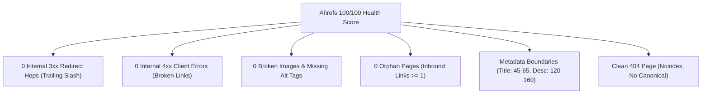
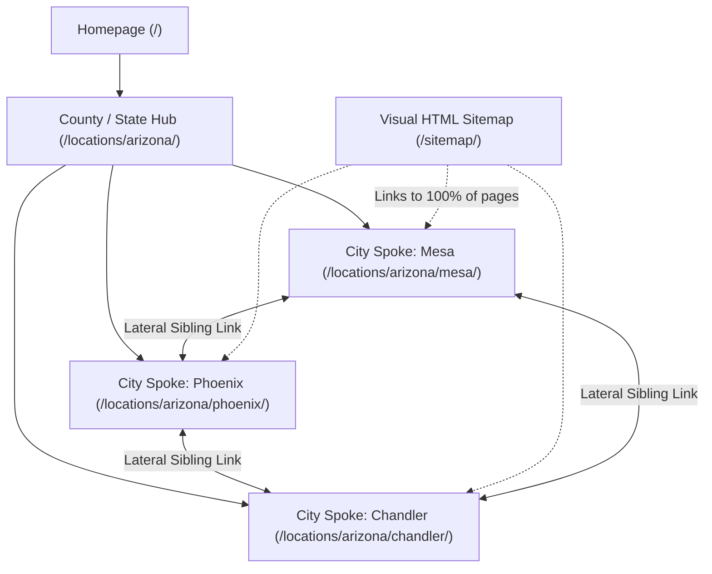

# Ahrefs 100/100 Health Score: Zero-Error Technical SEO Specification

> **GOAL**: Eliminate 100% of errors, warnings, and notices reported by Ahrefs Site Audit, SEMrush, and Screaming Frog. Achieve an undeniable **100/100 Site Health Score** upon first crawl.

---

## 1. Summary of Inviolable Ahrefs Health Metrics



---

## 2. Eliminating All 3xx Redirect Hops

### ❌ The Common Mistake:
Developers write internal links without a trailing slash (e.g., `<a href="/about">About</a>`). On static servers (Nginx/Apache), this causes an immediate `301 Moved Permanently` to `/about/`. Ahrefs flags every occurrence as **"Internal link to redirect"**.

### ✅ The Fix:
1. Enable `trailingSlash: true` in `next.config.ts`.
2. Every internal link in the entire application **MUST** end with a trailing slash:
   ```tsx
   // ❌ WRONG:
   <Link href="/services/commercial-repair">Commercial Repair</Link>
   <Link href="/blog">Blog</Link>

   // ✅ CORRECT:
   <Link href="/services/commercial-repair/">Commercial Repair</Link>
   <Link href="/blog/">Blog</Link>
   ```

---

## 3. Eliminating 4xx Client Errors & Broken Links

1. **Self-Contained Crawler Verification**:
   Before deploying, run the internal link verification script:
   ```bash
   python3 handoff/scripts/crawl-verifier.py --dir out
   ```
2. **Anchor Validation**:
   - Ensure every `href` resolves to an existing file in `out/`.
   - Never use dead placeholder links like `<a href="#">` or `<a href="/coming-soon">`. Use `<button>` elements for JavaScript triggers and real canonical routes for links.

---

## 4. Image Standards & Missing Alt Tags

Ahrefs immediately flags images without descriptive `alt` tags or with broken source paths.

### Rules:
1. **Descriptive Alt Attributes**:
   - Every `` must have an `alt` attribute describing the content and context.
   - Target length: **30 to 120 characters**.
   - Include the service and geographic location naturally (e.g. `alt="Commercial dual-port level 2 EV charging station installed in Mesa Arizona"`).
   - Never use generic placeholder text like `alt="image"`, `alt="icon"`, or `alt="photo"`.
2. **Valid Image Paths**:
   - All static images must reside in `/public/images/` and be referenced via absolute paths (`/images/filename.webp`).
   - Use WebP format for optimal compression and compatibility.

---

## 5. Zero Orphan Pages (Inbound Internal Link Hierarchy)

An **orphan page** is a page that exists in your `sitemap.xml` or on the server but has **zero internal links** pointing to it from other indexable pages. Ahrefs penalizes orphan pages heavily because search crawlers cannot discover them naturally.

### The Spiderweb Linking Hierarchy (Guaranteed 0 Orphans):
Every published page must receive internal links from **at least 3 distinct sources**:



1. **Upward Inlink**: City Spokes must link up to their parent State/County Hub.
2. **Lateral Sibling Inlinks**: Every city page must feature an *"Additional Nearby Service Areas"* section linking to 3–4 neighboring municipal pages.
3. **The Visual HTML Sitemap**: Maintain a dedicated `/sitemap/` page that categorically lists and links to **every single indexable URL** on the site.

---

## 6. Strict Metadata Boundaries

Ahrefs issues warnings if titles or meta descriptions are too short, too long, or duplicated across pages:

| Metadata Field | Minimum Length | Maximum Length | Optimal Strategy |
| :--- | :--- | :--- | :--- |
| `<title>` | **45 characters** | **65 characters** | `[Primary Service] in [City, State] | [Brand Name]`<br/>*Example: "Commercial EV Charger Installation in Mesa, AZ | EVChargerOne"* |
| `<meta name="description">` | **120 characters** | **160 characters** | High-CTR conversion hook with pricing, turnaround, and direct call to action.<br/>*Example: "Licensed commercial EV charger installation in Mesa, AZ. Level 2 & DC fast charging for businesses. 3-day turnaround. Call for free dispatch estimate."* |

---

## 7. The 404 Page Strict Isolation Rule

If a 404 page is misconfigured, Google Search Console and Ahrefs will report thousands of **"Soft-404"** errors.

### Mandatory 404 Configuration (`out/404.html`):
1. **HTTP Status Code**: Must return real HTTP `404 Not Found`.
2. **Robots Meta Tag**: Must contain `<meta name="robots" content="noindex, nofollow">`.
3. **Distinct Title**: Must be `<title>404 - Page Not Found | [Brand Name]</title>`.
4. **NO Canonical Tag**: A 404 page **MUST NEVER** have a `<link rel="canonical">` tag pointing to itself or to the homepage.
