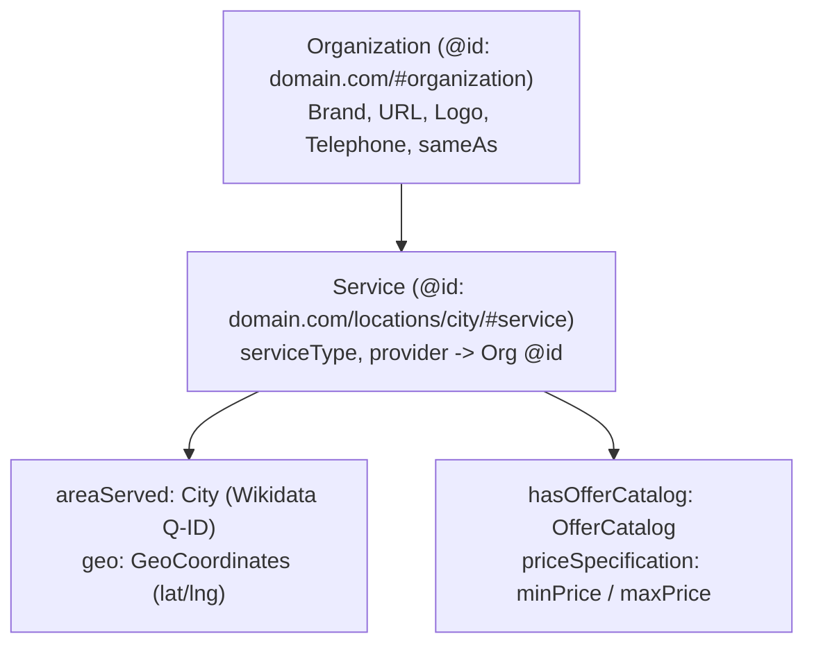

# No-GBP Entity Triangulation: Building Search Trust Without a Map Pin

> **THE CHALLENGE**: When operating programmatic lead-generation or dispatch websites without a physical walk-in Google Business Profile (GBP), Google and AI engines lack a Maps Knowledge Graph pin. You must compensate through **Multi-Node Entity Triangulation**.

---

## 1. The Fatal Trap: Never Fabricate Physical Addresses

### ❌ The Common Mistake:
Developers generate a `LocalBusiness` schema with a fake address like `123 Main Street, Suite 400, Mesa, AZ`.
- Google's semantic parsers verify addresses against postal databases, USPS delivery points, and Google Street View imagery.
- When an address is flagged as residential or non-existent, the entire domain is flagged for **Deceptive Entity Representation**.

### ✅ The Clean Solution:
Use `Organization` + `Service` with `areaServed` (`City` or `GeoCoordinates`). Never declare a walk-in address if one does not exist:



---

## 2. The Unified `@graph` JSON-LD Schema Architecture

Deploy a **single script tag** containing interconnected nodes linked by `@id`. This creates a complete Knowledge Graph subgraph that search engines parse in one pass:

```html
<script type="application/ld+json">
{
  "@context": "https://schema.org",
  "@graph": [
    {
      "@type": "Organization",
      "@id": "https://evchargerone.com/#organization",
      "name": "EVChargerOne",
      "url": "https://evchargerone.com",
      "logo": "https://evchargerone.com/images/logo.webp",
      "telephone": "+1-480-555-0199",
      "sameAs": [
        "https://www.wikidata.org/wiki/Q12345",
        "https://opencorporates.com/companies/us_az/123",
        "https://www.bbb.org/us/az/phoenix/profile/...",
        "https://www.trustpilot.com/review/evchargerone.com"
      ]
    },
    {
      "@type": "Service",
      "@id": "https://evchargerone.com/locations/arizona/mesa/#service",
      "name": "Commercial EV Charger Installation in Mesa, AZ",
      "serviceType": "Commercial EV Charger Installation",
      "provider": {
        "@id": "https://evchargerone.com/#organization"
      },
      "areaServed": {
        "@type": "City",
        "name": "Mesa",
        "sameAs": "https://en.wikipedia.org/wiki/Mesa,_Arizona",
        "geo": {
          "@type": "GeoCoordinates",
          "latitude": 33.4152,
          "longitude": -111.8315
        }
      },
      "hasOfferCatalog": {
        "@type": "OfferCatalog",
        "name": "Commercial Installation Tiers",
        "itemListElement": [
          {
            "@type": "Offer",
            "name": "Level 2 Dual-Port Commercial Charging Station",
            "priceSpecification": {
              "@type": "PriceSpecification",
              "priceCurrency": "USD",
              "minPrice": "2800",
              "maxPrice": "6500"
            }
          }
        ]
      }
    },
    {
      "@type": "WebPage",
      "@id": "https://evchargerone.com/locations/arizona/mesa/#webpage",
      "url": "https://evchargerone.com/locations/arizona/mesa/",
      "name": "Commercial EV Charger Installation in Mesa, AZ | EVChargerOne",
      "isPartOf": {
        "@id": "https://evchargerone.com/#website"
      },
      "about": {
        "@id": "https://evchargerone.com/locations/arizona/mesa/#service"
      },
      "citation": [
        "https://www.mesaaz.gov/business/development-services",
        "https://www.nfpa.org/codes-and-standards/70"
      ],
      "speakable": {
        "@type": "SpeakableSpecification",
        "cssSelector": [".bluf-answer", "h1", "h2"]
      }
    },
    {
      "@type": "BreadcrumbList",
      "@id": "https://evchargerone.com/locations/arizona/mesa/#breadcrumb",
      "itemListElement": [
        {
          "@type": "ListItem",
          "position": 1,
          "name": "Home",
          "item": "https://evchargerone.com/"
        },
        {
          "@type": "ListItem",
          "position": 2,
          "name": "Arizona",
          "item": "https://evchargerone.com/locations/arizona/"
        },
        {
          "@type": "ListItem",
          "position": 3,
          "name": "Mesa",
          "item": "https://evchargerone.com/locations/arizona/mesa/"
        }
      ]
    }
  ]
}
</script>
```

---

## 3. Wikidata & Wikipedia Entity Grounding

Every municipality, county, and technical trade has an official **Wikidata URI** and **Wikipedia page**. Embedding these links in `sameAs` allows Google's entity disambiguation models and LLM cross-encoders to immediately anchor your page to recognized knowledge graph nodes:

```typescript
// Location entity mapping table
export const LOCATION_ENTITIES = {
  mesa: {
    name: 'Mesa',
    state: 'Arizona',
    wikiUri: 'https://en.wikipedia.org/wiki/Mesa,_Arizona',
    wikidataUri: 'https://www.wikidata.org/wiki/Q48261',
    lat: 33.4152,
    lng: -111.8315,
    utility: 'Salt River Project (SRP) & Arizona Public Service (APS)',
    permitOffice: 'City of Mesa Development Services Department',
  },
  phoenix: {
    name: 'Phoenix',
    state: 'Arizona',
    wikiUri: 'https://en.wikipedia.org/wiki/Phoenix,_Arizona',
    wikidataUri: 'https://www.wikidata.org/wiki/Q16556',
    lat: 33.4484,
    lng: -112.0740,
    utility: 'Arizona Public Service (APS)',
    permitOffice: 'City of Phoenix Planning & Development Department',
  },
};
```

---

## 4. Unstructured Citations & Third-Party Triangulation

Without a GBP feeding Google Maps, Google cross-references your brand across independent secondary platforms:
1. **Secondary Business Directories**: Yelp, Apple Maps, Bing Places, YellowPages, Better Business Bureau (BBB).
2. **Trade & Corporate Registries**: OpenCorporates, state Secretary of State corporate registration search, professional associations (e.g. FMC, NECA, IICRC).
3. **Consistent NAP+W Footprint**:
   - Registered Legal Brand Name: Exact match across all directory nodes.
   - Dispatch Phone Number: Uniform local area code across all mentions.
   - Canonical Domain: Always point to the canonical HTTPS root.
