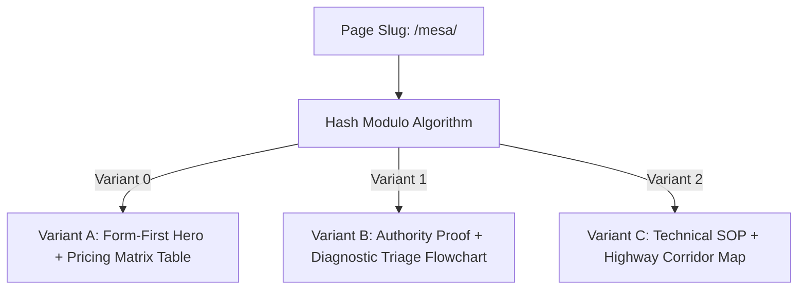

# Dynamic DOM & Anti-Doorway Engine: Beating the Scaled Content Update

> **THE 2026 ALGORITHMIC REALITY**: Google’s SpamBrain algorithms actively cluster and demote programmatic websites where hundreds of location pages share identical Document Object Model (DOM) node trees and find-and-replace text. This specification details how to achieve structural and semantic uniqueness across all pages.

---

## 1. The Dynamic DOM Spintax Architecture (3 Rotating Layouts)

Instead of forcing all location pages into a single static template, the site must rotate between **3 to 4 distinct layout wireframes**. The assignment is deterministic, driven by the MD5 hash of the page slug:

$$\text{Variant Index} = |\text{hash}(\text{slug})| \pmod 3$$

### The 3 Structural Wireframes:

#### Wireframe Variant A: Direct Form Hero (Lead Capture Focus)
- **Hero**: Split-screen. Instant 3-step qualification form on the right; H1 + 3 bullet checkmarks on the left.
- **Section 2**: Comprehensive HTML pricing and turnaround matrix table (`<table>`).
- **Section 3**: BLUF direct answer capsule with bold entity anchors.
- **Section 4**: Local utility rebate calculator.
- **Section 5**: 5-question local FAQ accordion.

#### Wireframe Variant B: Authority Proof & Diagnostic (Credibility Focus)
- **Hero**: Full-width centered banner. Dual CTA buttons (Call / Quote), 4 contractor license badges, and real customer review count.
- **Section 2**: Interactive symptom triage diagnostic flowchart.
- **Section 3**: Step-by-step local permit submission guidelines.
- **Section 4**: Inline lead form container + client testimonial gallery.
- **Section 5**: 8-question extended FAQ grid.

#### Wireframe Variant C: Technical SOP & Compliance (Engineering Focus)
- **Hero**: Left-aligned technical H1, live dispatch status alert pill, and immediate BLUF summary box.
- **Section 2**: 4-phase dispatch SOP (Site Audit -> Plan Permitting -> Trenching & Conduits -> Final Inspection).
- **Section 3**: Highway corridor and regional dispatch radius matrix table.
- **Section 4**: Side-by-side comparison table (Direct Dispatch vs. Lead Broker Resellers).
- **Section 5**: Full technical FAQ accordion.

---

## 2. The 3-of-4 Local Material Gate (Anti-Doorway Standard)

Every city, county, or regional spoke page **MUST** satisfy at least 3 of these 4 real-world data points before publication:

1. **Local Pricing & Turnaround Data**:
   - Documented cost ranges ($/£) and installation timelines specific to that municipality (e.g. *"Commercial L2 installation in Mesa ranges from $2,800 to $6,500 with a 3–5 day average turnaround"*).
2. **Hyper-Local Utility & Permit Entities**:
   - Specifically named electric utilities (e.g., Salt River Project, APS, PGE) and official municipal permit departments (e.g., City of Mesa Planning & Development).
3. **Distinct City FAQ Answer**:
   - At least one FAQ question and answer addressing unique local municipal requirements (e.g., solar integration amendments, coastal salt air corrosion mitigation, or freeze-thaw ground depth).
4. **Local Proof & Verified Personnel**:
   - Real client testimonials, localized contractor CCB/license numbers, or localized service dispatch radius notes (e.g., *"Serving all zip codes across East Valley: 85201, 85202, 85203 within 45 minutes"*).

---

## 3. The Sibling Test: Localizing the Real-World Problem

### ❌ The Common AI Failure Mode:
Writing:
- Page 1: *"We provide top-rated mold remediation in Phoenix."*
- Page 2: *"We provide top-rated mold remediation in Scottsdale."*
This is pure commodity substitution and triggers immediate doorway penalties.

### ✅ The Sibling Test Standard:
Localize the **engineering or environmental challenge**:
- **Phoenix Page**: Focus on intense summer monsoon flooding, flat roof pooling, and AC condensate drain line backups inside stucco attics.
- **Scottsdale Page**: Focus on luxury custom home construction, multi-zone HVAC basement moisture intrusion, and zero-VOC botanical sanitization protocols.

---

## 4. Algorithmic Near-Duplicate Test (Jaccard Similarity < 0.50)

To ensure Google never detects duplicate content across location hubs:
- Compute 5-word shingles across the body copy of all generated pages.
- Strip site-wide boilerplate (header, navigation, footer, privacy policies appearing on >30% of pages).
- The pairwise **Jaccard Similarity** between any two location pages must remain strictly **below 0.50**:

$$J(A, B) = \frac{|A \cap B|}{|A \cup B|} < 0.50$$

This is automatically enforced by running `python3 handoff/scripts/gatekeeper.py --dir out`.
