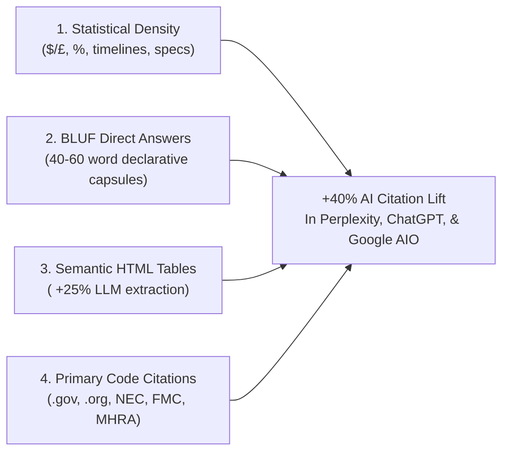

# GEO, AEO & Content Writing SOP: Dominating AI Citations & Search Answers

> **RESEARCH FOUNDATION**: Based on the Princeton / Georgia Tech / Allen AI landmark study (*"GEO: Generative Engine Optimization"*), AI search engines (Perplexity, ChatGPT Search, Gemini, Claude, and Google AI Overviews) prioritize web passages featuring **statistical density**, **concise factual answers**, **structured comparison tables**, and **primary source citations**.

---

## 1. The 4 Proven Levers for +40% AI Citation Frequency



---

## 2. BLUF (Bottom Line Up Front) Direct Answer Capsules

Generative engine cross-encoders (ColBERT, BGE, Cohere) evaluate text chunks based on semantic salience. Over **44% of citations** are pulled from the first 100 tokens of an H2 section.

### BLUF Capsule Rules:
- **Length**: Strictly **40 to 60 words**.
- **Placement**: Directly beneath the primary question-style `<h2>` or inside the hero card.
- **Entity Bolding**: Bold key nouns, pricing parameters, timelines, and municipal entities.
- **Zero Conversational Fluff**: Never begin with *"In today's fast-paced world"* or *"Are you wondering about..."*. State the direct conclusion immediately.

### Template:
```html
<section class="bluf-section my-6">
  <h2 class="text-xl font-bold text-slate-900 mb-2">
    How Long Does Commercial EV Charger Permitting Take in Maricopa County?
  </h2>
  <div class="bluf-answer p-4 rounded-xl bg-slate-50 border border-slate-200 text-slate-800 text-sm leading-relaxed">
    <p>
      In <strong>Maricopa County, Arizona</strong>, commercial Level 2 EV charging station plan review takes 
      <strong>5 to 7 business days</strong> through the City of Phoenix Planning &amp; Development Department. 
      Fast-track standard plan reviews for dedicated <strong>240V/50A circuits</strong> without main switchgear 
      upgrades can be approved within <strong>48 hours</strong> under municipal administrative guidelines.
    </p>
  </div>
</section>
```

---

## 3. Tabular Data Formatting (`<table>` for +25% Citation Lift)

LLMs parse structured tabular data with significantly higher confidence than prose. Every service or location page must include at least one clean HTML table:

```html
<div class="w-full overflow-x-auto my-6 border border-slate-200 rounded-xl shadow-xs">
  <table class="w-full text-left text-sm text-slate-700">
    <thead class="bg-slate-100 text-xs uppercase font-bold text-slate-900 border-b border-slate-200">
      <tr>
        <th class="py-3 px-4">Installation Scope</th>
        <th class="py-3 px-4">Standard Cost Range</th>
        <th class="py-3 px-4">Average Turnaround</th>
        <th class="py-3 px-4">Permit Authority</th>
      </tr>
    </thead>
    <tbody class="divide-y divide-slate-200 bg-white">
      <tr>
        <td class="py-3 px-4 font-medium text-slate-900">Residential 240V/50A Dedicated Line</td>
        <td class="py-3 px-4">$750 - $1,400</td>
        <td class="py-3 px-4">3 - 5 Hours</td>
        <td class="py-3 px-4">Local Municipal Building Dept</td>
      </tr>
      <tr>
        <td class="py-3 px-4 font-medium text-slate-900">Commercial Dual-Port L2 Station</td>
        <td class="py-3 px-4">$2,800 - $6,500</td>
        <td class="py-3 px-4">3 - 5 Days</td>
        <td class="py-3 px-4">Commercial Plan Review Board</td>
      </tr>
      <tr>
        <td class="py-3 px-4 font-medium text-slate-900">DC Fast Charger (50kW+) System</td>
        <td class="py-3 px-4">$28,000 - $75,000</td>
        <td class="py-3 px-4">2 - 4 Weeks</td>
        <td class="py-3 px-4">Utility Transformer Upgrade + City Permit</td>
      </tr>
    </tbody>
  </table>
</div>
```

---

## 4. Strict Copywriting Discipline & Anti-AI Rules

### Rule 1: The Zero Em-Dash Mandate
- **NEVER use em-dashes (`—`) anywhere in copy or metadata**.
- AI models use em-dashes compulsively. In human editorial copy, replace them with standard hyphens surrounded by spaces (` - `), commas, or clean parentheses.

### Rule 2: The Banned AI Cliche List
Prior to production compilation, all copy must be checked and sanitized against these forbidden AI tells:
- `as an AI language model` / `as an AI`
- `machine extract` / `direct answer`
- `in today's fast-paced world`
- `it's important to remember`
- `in conclusion`
- `a testament to`
- `delve into` / `dive into`
- `tapestry of`
- `beacon of`
- `plethora of`

### Rule 3: Single `<h1>` & Sequential Heading Hierarchy
- Exactly **one `<h1>`** per page.
- Heading tags must follow unbroken order: `H1` -> `H2` -> `H3`. Skipping heading levels (e.g. jumping from `H2` directly to `H4`) is strictly prohibited.

### Rule 4: Outbound Authoritative Citations
- Every page must link out to at least **1 to 3 authoritative external sources**:
  - Official government departments (`.gov`, `.gov.uk`, `legislation.gov.uk`).
  - Recognized professional associations (`.org`, `nfpa.org`, `familymediationcouncil.org.uk`).
  - Official regulatory and code portals (`energy.gov`, `osha.gov`, `epa.gov`).
- Always use `target="_blank" rel="noopener"`.
