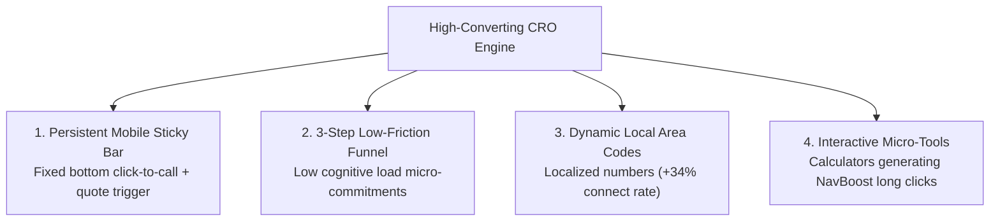

# High-Converting CRO Engine: Maximizing Calls & Qualified Leads

> **THE CONVERSION REALITY**: Organic searchers and AI Overview readers have immediate intent and low attention spans. They skipped the Map Pack to find a direct answer. Your landing page must convert visitors into phone calls and lead form submissions within **5 seconds of arrival**.

---

## 1. The 4 Pillars of High-Velocity Lead Monetization



---

## 2. Persistent Mobile Sticky Call Bar

On mobile viewports (`< 768px`), over **65% of all emergency and local service conversions** happen via direct telephone calls. A fixed bottom bar ensures the conversion action is always accessible regardless of scroll depth:

### Blueprint:
- Fixed to the bottom of the viewport: `fixed bottom-0 left-0 right-0 z-50`.
- Dual high-contrast buttons:
  - **Left (50% Width)**: `[ 📞 Call Dispatch: (XXX) XXX-XXXX ]` (High-contrast emerald or brand accent, direct `tel:` protocol).
  - **Right (50% Width)**: `[ ⚡ Get Instant Quote ]` (Contrasting dark/amber button, smooth scrolls to `#lead-form`).

```tsx
'use client';

import React from 'react';
import { PhoneCall, Zap } from 'lucide-react';

interface StickyBarProps {
  phone: string;
  formattedPhone: string;
}

export const MobileStickyCallBar: React.FC<StickyBarProps> = ({
  phone,
  formattedPhone,
}) => {
  return (
    <div className="fixed bottom-0 left-0 right-0 z-50 bg-white/95 dark:bg-zinc-950/95 backdrop-blur-md border-t border-slate-200 dark:border-zinc-800 p-2.5 sm:hidden shadow-2xl">
      <div className="grid grid-cols-2 gap-2">
        <a
          href={`tel:${phone}`}
          className="flex items-center justify-center gap-1.5 py-3 px-2 rounded-xl bg-emerald-600 hover:bg-emerald-500 text-white font-bold text-xs uppercase tracking-wider shadow-sm transition active:scale-98"
        >
          <PhoneCall className="w-4 h-4 shrink-0" />
          <span>Call Dispatch</span>
        </a>
        <a
          href="#lead-form"
          className="flex items-center justify-center gap-1.5 py-3 px-2 rounded-xl bg-slate-900 dark:bg-zinc-800 hover:bg-slate-800 text-white font-bold text-xs uppercase tracking-wider shadow-sm transition active:scale-98"
        >
          <Zap className="w-4 h-4 text-amber-400 shrink-0" />
          <span>Fast Quote</span>
        </a>
      </div>
    </div>
  );
};
```

---

## 3. 3-Step Low-Friction Lead Qualification Form

Never present an intimidating 8-field static form upfront. Multi-step forms reduce cognitive friction by starting with low-commitment choices:

### The 3 Micro-Commitment Steps:
1. **Step 1: Intent & Scope** (Zero Personal Info)
   - Large clickable radio cards (e.g. *"Residential Level 2"* vs. *"Commercial Dual-Port"*).
2. **Step 2: Property & Timeline** (Low Friction)
   - Dropdown: Electrical Panel Capacity (`200A`, `100A`, `Unsure`).
   - Text input: Service Zip Code (`pattern="[0-9]{5}"`).
3. **Step 3: Contact Details & Dispatch Confirmation**
   - Full Name, Phone Number, and Optional Project Notes.
   - Micro-copy: *"Your information is never shared or sold to third-party aggregators."*

---

## 4. Local Area Code Dynamic Mapping (+34% Connect Rate)

Consumers distrust cold national toll-free numbers (`800`, `888`, `877`) for local emergency or trade services. Localized area codes increase telephone connect rates by up to **34%**:

```typescript
export const REGIONAL_PHONE_ROUTER = {
  // Arizona Markets
  'mesa': { phone: '+14805550199', formatted: '(480) 555-0199' },
  'phoenix': { phone: '+16025550144', formatted: '(602) 555-0144' },
  'glendale': { phone: '+16235550188', formatted: '(623) 555-0188' },
  // Oregon Markets
  'bend': { phone: '+15415550177', formatted: '(541) 555-0177' },
  'portland': { phone: '+15035550122', formatted: '(503) 555-0122' },
  // UK Markets
  'bristol': { phone: '+441175550133', formatted: '0117 555 0133' },
  'manchester': { phone: '+441615550155', formatted: '0161 555 0155' },
};
```

---

## 5. Interactive Micro-Tools (Winning the NavBoost Loop)

Google's **NavBoost** system evaluates user click satisfaction across rolling 13-month streams. A searcher who bounces back to the SERP in 10 seconds signals poor relevance. A searcher who stays for **90+ seconds** and interacts with an on-page tool sends a powerful ranking confirmation.

### High-Dwell Interactive Widgets:
- **EV Sizing Calculator**: Select vehicle battery kWh + commute miles -> calculates recommended charger kW and dedicated breaker amperage.
- **Mold Remediation Estimator**: Select room type (attic, basement, crawlspace) + square footage -> outputs estimated drying timeline and containment requirements.
- **Mediation Cost vs. Court Fee Estimator**: Select dispute type -> compares standard £3,000 mediation package vs. £25,000+ contested court litigation.
