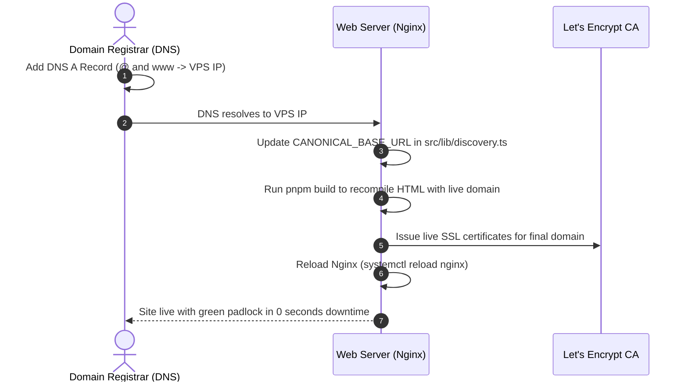

# Deployment & Hosting SOP: Zero-Downtime Live Production

> **MANDATE**: Deploy statically compiled Next.js applications (`output: 'export'`) to Ubuntu VPS (Nginx) or Cloudflare Pages with SSL encryption, HTTP/2 performance, and seamless domain switching.

---

## 1. Nginx Production Server Configuration

When hosting on a Linux VPS (Ubuntu/Debian), use this hardened, high-performance Nginx server block:

```nginx
server {
    listen 80;
    listen [::]:80;
    server_name example.com www.example.com;

    # Certbot ACME Challenge Path
    location /.well-known/acme-challenge/ {
        root /var/www/certbot;
    }

    # Redirect all HTTP traffic to HTTPS
    location / {
        return 301 https://$host$request_uri;
    }
}

server {
    listen 443 ssl http2;
    listen [::]:443 ssl http2;
    server_name example.com www.example.com;

    root /var/www/example.com/out;
    index index.html;

    # SSL Certificates (Managed by Certbot)
    ssl_certificate /etc/letsencrypt/live/example.com/fullchain.pem;
    ssl_certificate_key /etc/letsencrypt/live/example.com/privkey.pem;
    ssl_protocols TLSv1.2 TLSv1.3;
    ssl_ciphers HIGH:!aNULL:!MD5;

    # Mandatory Security Headers (100/100 Best Practices)
    add_header Strict-Transport-Security "max-age=31536000; includeSubDomains; preload" always;
    add_header X-Content-Type-Options "nosniff" always;
    add_header X-Frame-Options "SAMEORIGIN" always;
    add_header Cross-Origin-Opener-Policy "same-origin" always;
    add_header Referrer-Policy "strict-origin-when-cross-origin" always;

    # Compression (Gzip & Brotli)
    gzip on;
    gzip_types text/plain text/css application/json application/javascript text/xml application/xml application/xml+rss text/javascript image/svg+xml;

    # Trailing Slash Handling & Clean Route Resolution
    location / {
        try_files $uri $uri/ /404.html;
    }

    # Static Assets Long-Term Caching
    location ~* \.(webp|png|jpg|jpeg|svg|ico|css|js|woff2)$ {
        expires 1y;
        add_header Cache-Control "public, max-age=31536000, immutable";
    }

    # Explicit 404 Error Page
    error_page 404 /404.html;
    location = /404.html {
        internal;
    }
}
```

---

## 2. SSL Activation via Let's Encrypt (Certbot)

Run Certbot to obtain and auto-renew TLS certificates:

```bash
sudo certbot --nginx -d example.com -d www.example.com --non-interactive --agree-tos -m admin@example.com
```

---

## 3. Zero-Downtime Domain Transition SOP

When a site is developed on a temporary staging domain (e.g. `swanmediation.online`) and is ready to switch to the final domain (e.g. `aminoacidsupplements.co`):



1. **Client DNS Action**: Client sets an `A` record pointing the root `@` and `www` to the VPS server IP.
2. **Rebuild Static HTML**: In `src/lib/discovery.ts`, update `CANONICAL_BASE_URL = 'https://example.com'` and run `pnpm build`.
3. **Nginx Symlink & SSL**: Update the Nginx `server_name` directive and run Certbot.
4. **Reload**: `sudo nginx -t && sudo systemctl reload nginx`.

---

## 4. Post-Deployment Double-Assurance Crawl

Run the automated verification script against the live endpoint:

```bash
python3 handoff/scripts/crawl-verifier.py --url https://example.com/
```

Verify:
- [ ] 0 HTTP 3xx redirects across internal navigation.
- [ ] 0 HTTP 4xx errors on all pages and assets.
- [ ] 0 broken images or unrendered SVG icons.
- [ ] HSTS and COOP security headers return in response.
