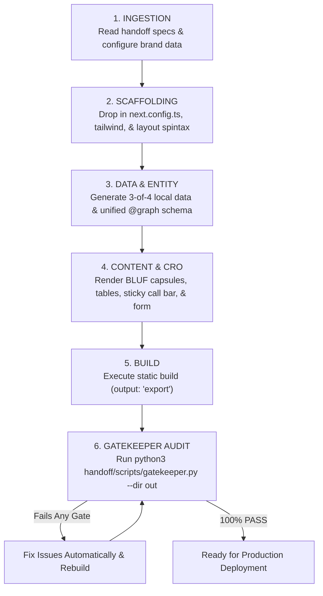

# Autonomous Site Development Handoff Kit (2026 Enterprise Edition)

> **FOR CODING AGENTS & HUMAN DEVELOPERS**: This directory contains the complete, self-contained architecture, design tokens, technical specifications, compliance rules, ready-to-use component templates, and pre-launch verification scripts required to build, audit, and launch enterprise-grade web applications in **one single pass** with **zero hallucinations**, **zero visual bugs**, and **100/100 performance and health scores**.

---

## 🎯 Purpose of This Handoff Kit

This kit was engineered from hundreds of hours of production deployment, real-world bug fixes, client feedback, and algorithmic audit reports across Google Core/Spam Updates, Google Search Console, Ahrefs Site Audit, and Core Web Vitals testing.

When an autonomous coding agent is assigned to build a new website in **any niche** (e.g. Local Services, Legal/Mediation, Healthcare/Biotech, Home Services, SaaS, Directory/Aggregator), it must ingest this entire directory and execute the build **strictly adhering to these rules**. 

### 🚫 The Zero-Tolerance List (Never Make These Mistakes Again)
1. **Never generate generic AI slop**: No bland gray hero sections, no empty voids, no repetitive template footprints.
2. **Never produce empty UI slots**: No missing image boxes, no unrendered protocol step numbers, no empty FAQ bars with `(?)`, no empty brackets `[]` or parentheses `()`.
3. **Never output walls of plain unstyled text**: Key takeaways, opening summaries, and TL;DR capsules must use bold uppercase badge tags, colored pills, and structured bullet points.
4. **Never break Core Web Vitals**: LCP must be < 1.2s, CLS must be 0, INP must be < 50ms. Never hoist below-the-fold images into `<head>` preload tags.
5. **Never cause Ahrefs errors**: 0 internal 3xx redirects (always use trailing slashes), 0 4xx broken links, 0 broken images, 0 orphan pages.
6. **Never fabricate local entities**: Never invent fake street addresses for virtual or dispatch services. Use No-GBP Entity Triangulation (`Organization` + `Service` + `areaServed`).
7. **Never use em-dashes (`—`) in copy**: Use standard hyphens with spaces (` - `) or clean commas.
8. **Never skip heading levels**: Exactly one `<h1>` per page. Sequential hierarchy: `H1` -> `H2` -> `H3`.
9. **Never render form inputs without labels**: Every `<input>`, `<select>`, `<textarea>` must have an associated `<label htmlFor="...">`.
10. **Never deploy without running the Gatekeeper**: The site is NOT ready until `python3 scripts/gatekeeper.py --dir out` returns a **100% PASS** (exit code 0).

---

## 📂 Directory Inventory & Blueprint Map

| File / Folder | Topic | Purpose |
| :--- | :--- | :--- |
| [`00-MASTER-CODING-AGENT-PROTOCOL.md`](./00-MASTER-CODING-AGENT-PROTOCOL.md) | **Execution Protocol** | Operational rules, execution phases, step-by-step agent workflow. |
| [`01-DESIGN-AND-UI-UX-SYSTEM.md`](./01-DESIGN-AND-UI-UX-SYSTEM.md) | **UI/UX & Design** | Anti-AI slop design tokens, typography, hero blueprints, responsive grids, form accessibility. |
| [`02-CORE-WEB-VITALS-AND-PERFORMANCE.md`](./02-CORE-WEB-VITALS-AND-PERFORMANCE.md) | **CWV & Speed** | Next.js config, 100/100 CWV, LCP unhoisting, CLS prevention, deferred Matomo/GA4, security headers. |
| [`03-AHREFS-100-ZERO-ERROR-SPECIFICATION.md`](./03-AHREFS-100-ZERO-ERROR-SPECIFICATION.md) | **Ahrefs Audit** | Eliminating all 3xx redirects, 4xx errors, broken assets, orphan pages, and title/meta truncation. |
| [`04-GOOGLE-SEARCH-CONSOLE-AND-AI-DISCOVERY.md`](./04-GOOGLE-SEARCH-CONSOLE-AND-AI-DISCOVERY.md) | **GSC & AI Bots** | SOT `sitemap.xml`, AI crawler directives in `robots.txt`, `/llms.txt`, clean canonicalization, 404 isolation. |
| [`05-NO-GBP-ENTITY-TRIANGULATION-SPEC.md`](./05-NO-GBP-ENTITY-TRIANGULATION-SPEC.md) | **Entity SEO** | Single `@graph` JSON-LD schema, Wikidata `sameAs`, 3-of-4 material gates, zero fake addresses. |
| [`06-DYNAMIC-DOM-AND-ANTI-DOORWAY-ENGINE.md`](./06-DYNAMIC-DOM-AND-ANTI-DOORWAY-ENGINE.md) | **Anti-Spam DOM** | 3 rotating wireframes by slug hash, anti-doorway 5-word shingle Jaccard similarity (< 0.50). |
| [`07-GEO-AEO-AND-CONTENT-WRITING-SOP.md`](./07-GEO-AEO-AND-CONTENT-WRITING-SOP.md) | **GEO / AEO Content** | BLUF 40-60 word direct answers, semantic HTML `<table>` elements, entity bolding, zero em-dashes. |
| [`08-HIGH-CONVERTING-CRO-ENGINE.md`](./08-HIGH-CONVERTING-CRO-ENGINE.md) | **Conversion CRO** | Mobile persistent sticky call bar, 3-step qualification form, dynamic local area code routing. |
| [`09-DEPLOYMENT-AND-HOSTING-SOP.md`](./09-DEPLOYMENT-AND-HOSTING-SOP.md) | **DevOps & VPS** | Nginx configs, SSL activation, DNS propagation, zero-downtime domain switching. |
| [`templates/`](./templates/) | **Code Templates** | Production-ready Next.js configs, Tailwind tokens, and 6 core React components. |
| [`scripts/`](./scripts/) | **Automated Auditing** | Standalone Python test harnesses: `gatekeeper.py` (10 Gates) and `crawl-verifier.py`. |

---

## ⚡ Quick Start: How an Agent Must Build a New Site

When given a brief (e.g., *"Build an emergency mold remediation lead-gen site for 20 cities in Florida"*):



1. **Scaffold with Production Standards**:
   - Copy `templates/next.config.ts` into site root (enforces `output: 'export'`, `trailingSlash: true`, `productionBrowserSourceMaps: true`).
   - Use `templates/components/DynamicLayoutSpintax.tsx` for location/service money pages to guarantee rotating DOM trees.
2. **Implement No-GBP Entity Triangulation**:
   - Use `templates/lib/schema-generator.ts` to build the unified `@graph` JSON-LD schema with real Wikidata links and `areaServed` coordinates.
3. **Embed Core CRO & Performance Components**:
   - Add `templates/components/MobileStickyCallBar.tsx` for high-converting mobile phone dispatch.
   - Add `templates/components/MultiStepLeadForm.tsx` with explicit accessible labels.
   - Add `templates/components/MatomoTracker.tsx` in `src/app/layout.tsx` for zero-thread-blocking analytics.
   - Add `templates/components/CookieBanner.tsx` for statutory privacy compliance.
4. **Compile & Audit Before Handing Off**:
   ```bash
   pnpm build # or npm run build
   python3 handoff/scripts/gatekeeper.py --dir out
   ```
   **DO NOT** present the site to the user until `gatekeeper.py` outputs:
   `🏆 OVERALL GATEKEEPER VERDICT: PASS (Site Authorized for Live Launch)`.
